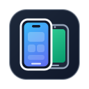

<div align="center">
  

  # Devices for Antigravity

  **Boot, stream, and control local iOS simulators and Android emulators right beside your Antigravity conversation.**

  [](https://github.com/harysuryanto/antigravity-devices/actions/workflows/ci.yml)
  [](https://github.com/harysuryanto/antigravity-devices/releases)
  [-111827)](#prerequisites)
  [](LICENSE)
</div>

<br />

<!-- TODO: Replace with a 10–15s recording showing an Antigravity chat on the left driving an app while the live iOS/Android preview updates in the right Auxiliary Pane -->
<div align="center">
  
  <p><em>Placeholder: <code>docs/images/hero-demo.gif</code> — Agent conversation on the left, live interactive simulator streaming in the Devices side pane on the right.</em></p>
</div>

---

## Stop Alt-Tabbing Between Windows

When building or testing React Native, Expo, Flutter, Swift, or Kotlin apps with Antigravity, constantly switching between chat, Xcode Simulator, and Android Emulator breaks your flow.

**Devices** (`antigravity-devices`) embeds your local simulators and emulators directly into Antigravity’s **Auxiliary Pane**:
- **Watch your agent work in real time** as it taps, types, navigates, and dogfoods your mobile app.
- **Jump in instantly** with mouse/touch input, keyboard typing, rotation, screenshots, and hardware keys—without leaving the conversation window.
- **Zero cloud, zero latency overhead**—everything streams over local loopback (`127.0.0.1`) on your Mac.

---

## Features

- **iOS + Android in One Panel** — Discover all local Xcode iOS simulators and Android SDK AVDs in a single searchable picker. Boot stopped devices (`Start`) or attach to running ones (`Open`) in one click.
- **Auto-Opens During Mobile Tasks** — Ships with a bundled agent rule (`rules/AGENTS.md`) so Antigravity automatically opens the Devices panel whenever you ask it to run, test, debug, or inspect a mobile app (pairs seamlessly with `agent-device`, `xcrun simctl`, and `adb`).
- **Persistent Multi-Device Tabs** — Keep an iPhone and a Pixel open side-by-side in tabs and switch instantly. Returning to **All devices** or closing a tab never kills your underlying simulator or emulator.
- **Compact Hardware & Dev Controls**
  - **iOS:** Bottom dock (`Home`, `Rotate`, `Screenshot`, `Inspect`) + top-bar **WebKit Inspector** and **iOS tools** drawer, powered by universal `serve-sim`.
  - **Android:** Bottom hardware dock (`Back`, `Home`, `Recents`, `Power`) + **Android tools** drawer, powered out of the box by `serve-emu` (with optional hardware-accelerated streaming via T3 Code’s Expo Device Hub + VideoToolbox).
- **Feels Built Into Antigravity** — Synchronizes live with Antigravity Light & Dark Appearance themes, typography, and window zoom, with a clean resolution + live FPS telemetry bar.
- **100% Local & Private** — Preview HTTP and WebSocket streams bind strictly to `127.0.0.1`. Screen contents and tokens are never logged or sent externally.

---

## Screenshots

<!-- TODO: Replace placeholders below with actual screenshots (recommended width: 1400px–1600px PNG/WebP) -->
| Unified Device Picker | Multi-Device Tabs (Light & Dark) |
| --- | --- |
|  |  |
| *Placeholder: `docs/images/device-picker.png` — Grouped iOS & Android inventory with instant search and status dots.* | *Placeholder: `docs/images/live-preview-tabs.png` — Persistent tabs, live FPS bar, and compact hardware dock in Light/Dark mode.* |

---

## Install

### Quick Install (macOS)

Download and install the latest release into Antigravity using `agy`:

```sh
curl -fsSL https://github.com/harysuryanto/antigravity-devices/releases/latest/download/antigravity-devices-v0.5.0.tar.gz | tar -xz \
  && agy plugin install ./antigravity-devices \
  && rm -rf ./antigravity-devices
```

*(Or grab the `.tar.gz` / `.zip` archive manually from [GitHub Releases](https://github.com/harysuryanto/antigravity-devices/releases), extract it, and run `agy plugin install ./antigravity-devices`.)*

### Prerequisites

| Requirement | Notes |
| --- | --- |
| **macOS** | Apple Silicon (`arm64`) or Intel (`x86_64`) |
| **Antigravity App** | Standalone macOS desktop app with the `agy` CLI enabled |
| **Node.js 22+** | Auto-detected across `PATH`, Homebrew, `nvm`, `fnm`, `volta`, `asdf`, and `mise` |
| **Xcode** *(for iOS)* | Xcode + at least one iOS Simulator runtime installed |
| **Android SDK** *(for Android)* | `adb` (Platform-Tools), `emulator`, and at least one configured AVD |

---

## Quick Start

1. **Open manually anytime:** In any Antigravity conversation, click **+ → Plugins → Devices** to open the side panel, then click **Open** (running) or **Start** (stopped) next to any simulator or emulator.
2. **Or just ask Antigravity:** Try one of these prompts in chat—the Devices panel will open automatically:
   - *"Open the Devices panel to preview my running iOS simulator"*
   - *"Start an Android emulator and test the login flow of my app"*
   - *"List available iOS simulators and Android emulators"*

---

## Optional: Accelerated Android Streaming

Android streaming works **out of the box** with zero extra setup using the bundled `serve-emu` streamer.

If you already run **T3 Code’s local Expo Device Hub (`0.19.1`)** with `ffmpeg` (VideoToolbox) and an authenticated emulator gRPC endpoint, `antigravity-devices` automatically detects it and upgrades Android sessions to low-latency hardware-accelerated streaming.

---

## Troubleshooting

- **"Node.js 22+ is required" when opening Devices**
  macOS GUI apps launch with a minimal `PATH`. The launcher checks Homebrew, `nvm`, `fnm`, `volta`, `asdf`, and `mise` automatically, or you can point to a custom binary via `ANTIGRAVITY_DEVICES_NODE=/path/to/node`.
- **Android emulators don’t appear in the list**
  Ensure the Android SDK is installed (`~/Library/Android/sdk` or `ANDROID_HOME` / `ANDROID_SDK_ROOT`) and at least one AVD has been created in Android Studio’s Device Manager (`emulator -list-avds`).
- **Updated the plugin, but old UI or server behavior still shows**
  Close and reopen the **Devices** side panel, then restart **preview** under **Customizations → Installed → Devices → MCP**.

---

## Develop from Source

Building from source requires [Bun](https://bun.sh/) in addition to Node.js 22+.

```sh
git clone https://github.com/harysuryanto/antigravity-devices.git
cd antigravity-devices

bun install --frozen-lockfile
bun run build          # Stages runtime deps, patches serve-emu UI, builds dist/plugin
bun run validate       # Runs agy plugin validate --strict dist/plugin
bun run install:local  # Builds, validates, and installs locally into Antigravity
```

To package distributable release archives (`dist/release/*.tar.gz`, `*.zip`, and `SHA256SUMS.txt`):

```sh
bun run package:release
```

### Architecture Overview

| Path | Purpose |
| --- | --- |
| `plugin.json`, `mcp_config.json` | Plugin manifest and portable MCP server configuration |
| `bin/launch-server.sh` | Portable Node.js 22+ resolver for macOS GUI-launched MCP sessions |
| `rules/AGENTS.md` | Bundled rule instructing agents to auto-open Devices during mobile tasks |
| `scripts/server.mjs` | Stdio MCP App server (`open_devices`, plus panel-only `list_devices` & `open_device`) |
| `scripts/preview.html` | Unified picker, persistent tab bar, iframe preview stage, and live theme bridge |
| `scripts/devices.mjs` | Simulator/AVD discovery, booting, loopback port allocation, and worker reuse |
| `scripts/ios-preview.mjs` | Compact Antigravity chrome and live Appearance wrapper around `serve-sim` |
| `scripts/android-preview.mjs` | Selects accelerated T3 Hub gRPC capture or bundled `serve-emu` fallback |
| `patches/serve-emu-compact.patch` | Compact layout & theme patch applied to `serve-emu@0.1.0` during build |

---

## License

[MIT](LICENSE) © Hary Suryanto. Bundles [`serve-sim`](https://www.npmjs.com/package/serve-sim) and [`serve-emu`](https://www.npmjs.com/package/serve-emu) (both licensed under Apache-2.0).
