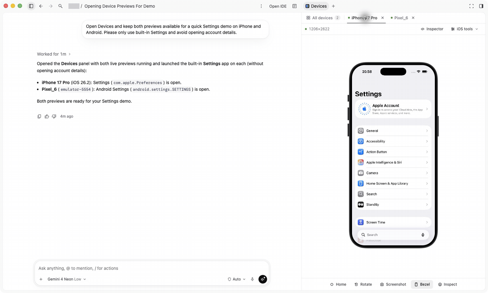
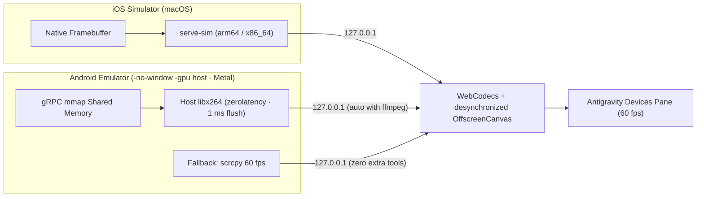
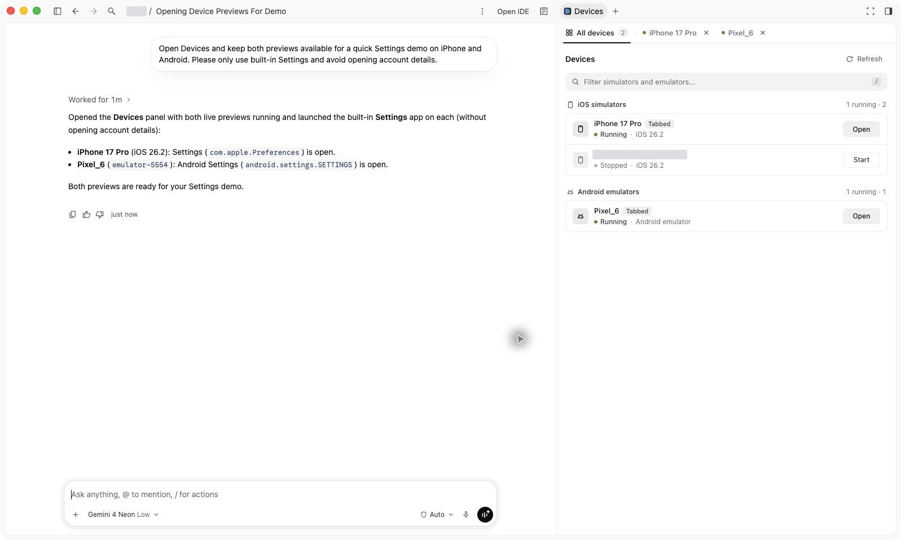
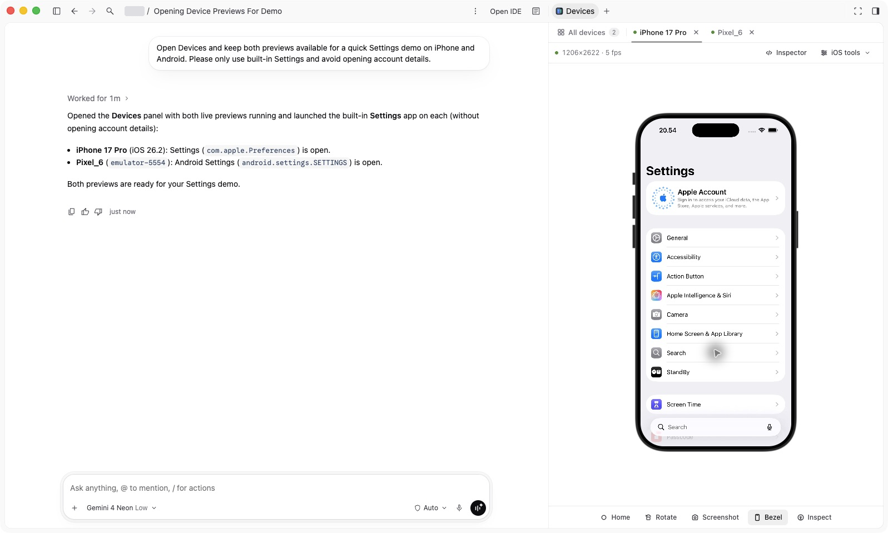
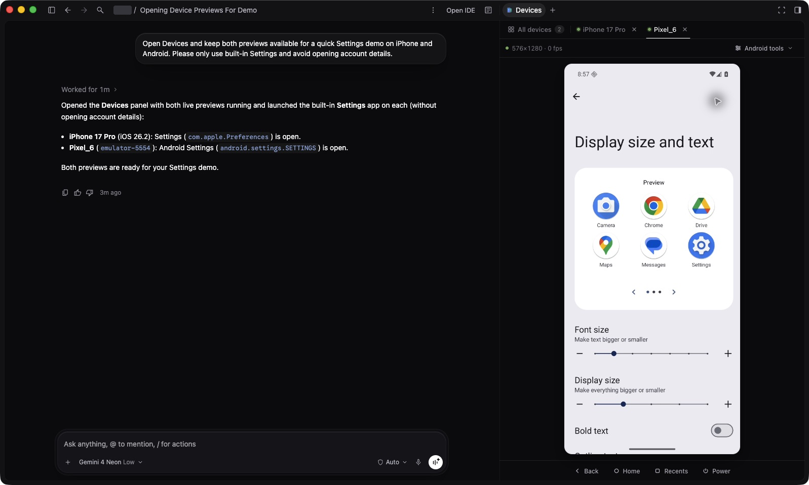

<div align="center">
  

  # Devices for Antigravity

  **Native-feel 60 fps iOS simulators and Android emulators inside Antigravity—engineered for ultra-low touch-to-display latency.**

  [](https://github.com/harysuryanto/antigravity-devices/actions/workflows/ci.yml)
  [](https://github.com/harysuryanto/antigravity-devices/releases)
  [-111827)](#prerequisites)
  [](LICENSE)
</div>

<br />

<div align="center">
  
  <p><em>Navigate iPhone Settings, switch to Pixel 6 instantly, and open Android display settings beside the same conversation.</em></p>
</div>

| 60 fps Hardware Decode | Zero Guest-CPU Tax | 1 ms Flush & `TCP_NODELAY` | Instant Tab Switching |
| :---: | :---: | :---: | :---: |
| `WebCodecs` + `desynchronized` `OffscreenCanvas` | Android `mmap` shared memory + host `libx264` | Zero-probe encoding & unbuffered touch dispatch | Persistent workers & iframes with zero flicker |

---

## Stop Alt-Tabbing Between Windows

When building or testing React Native, Expo, Flutter, Swift, or Kotlin apps with Antigravity, constantly switching between chat, Xcode Simulator, and Android Emulator breaks your flow—and typical embedded previews feel like laggy remote desktops.

**Devices** (`antigravity-devices`) embeds your local simulators and emulators directly into Antigravity’s **Auxiliary Pane** without sacrificing responsiveness:
- **Watch your agent work in real time** as it taps, scrolls, types, and dogfoods your mobile app smoothly at 60 fps.
- **Jump in instantly** with responsive mouse/touch input, keyboard typing, rotation, screenshots, and hardware keys—without leaving the conversation window.
- **100% local loopback streaming** over `127.0.0.1` with zero cloud hops and no external hub app required.

---

## Built for Speed: Why It Feels Native

Most embedded device previews rely on slow `adb` screenshot loops, guest-CPU screen recording, or buffered video queues that add noticeable lag. **Devices** eliminates each bottleneck end-to-end:

| Bottleneck | Typical Embedded Previews | Devices for Antigravity |
| --- | --- | --- |
| **Frame capture** | Slow `adb` screenshots or guest-CPU capture | **iOS:** native framebuffer (`serve-sim`) · **Android:** emulator `mmap` shared memory |
| **Encoding lag** | Hardware encoder queues & lookahead buffering | Host `libx264` (`ultrafast`, `zerolatency`, `nobuffer`, **1 ms** trailing access-unit flush) |
| **Rendering** | Main-thread `` / MJPEG repaints | Hardware **WebCodecs** decode straight to a `desynchronized` `OffscreenCanvas` |
| **Input latency** | Buffered shell commands or Nagle-delayed sockets | Direct HID (iOS) / `TCP_NODELAY` gRPC touch dispatch (Android) |
| **Emulator overhead** | Duplicate host window + software rendering | Headless `-no-window -gpu host` (macOS Metal) |
| **Switching devices** | Tear down & reconnect stream every switch | Persistent tab iframes & worker reuse (zero reconnect flicker) |

### Low-Latency Streaming Pipeline



- **iOS — Native Framebuffer Capture:** Uses universal macOS native binaries (`serve-sim`, `arm64` & `x86_64`) to capture directly from the iOS Simulator framebuffer and inject HID touch/keyboard events with minimal CPU overhead.
- **Android — Dual-Engine 60 fps Streaming (Built In):**
  1. **Zero-Latency Shared Memory (`mmap`) + Host `libx264` *(automatic when `ffmpeg` is installed)*:** Reads raw frames straight from the Android Emulator’s `mmap` shared memory via its local authenticated gRPC endpoint, encodes H.264 on the host with zero input probing (`-probesize 32 -analyzeduration 0 -fflags nobuffer -flags low_delay`), `-preset ultrafast -tune zerolatency`, and a **1 ms** trailing Annex-B access-unit flush, dispatches touch input immediately over `TCP_NODELAY`, and renders directly to a `desynchronized` `OffscreenCanvas`—keeping video encoding completely off the emulator’s guest CPU.
  2. **60 fps `scrcpy` + WebCodecs Fallback *(zero extra tools required)*:** When `ffmpeg` isn’t installed, seamlessly falls back to bundled `serve-emu` (`scrcpy` H.264 + `WebCodecs` decoding at up to **60 fps**), while booting stopped AVDs headless with `-no-window -gpu host` so Android renders on macOS Metal without a duplicate window.

---

## Features

- **iOS + Android in One Panel** — Discover all local Xcode iOS simulators and Android SDK AVDs in a single searchable picker. Boot stopped devices (`Start`) or attach to running ones (`Open`) in one click.
- **Auto-Opens During Mobile Tasks** — Ships with a bundled agent rule (`rules/AGENTS.md`) so Antigravity automatically opens the Devices panel whenever you ask it to run, test, debug, or inspect a mobile app (pairs seamlessly with `agent-device`, `xcrun simctl`, and `adb`).
- **Instant Multi-Device Tabs** — Keep an iPhone and a Pixel live side-by-side in persistent tabs and switch with zero reconnect flicker. Returning to **All devices** or closing a tab never kills your underlying simulator or emulator.
- **Compact Hardware & Dev Controls**
  - **iOS:** Bottom dock (`Home`, `Rotate`, `Screenshot`, `Bezel`, `Inspect`) + top-bar **WebKit Inspector** and **iOS tools** drawer, powered by universal `serve-sim`.
  - **Android:** Bottom hardware dock (`Back`, `Home`, `Recents`, `Power`) + **Android tools** drawer, powered by a dual-engine 60 fps streamer.
- **Feels Built Into Antigravity** — Synchronizes live with Antigravity Light & Dark Appearance themes, typography, full-stage `contain` scaling, and a clean resolution + live FPS telemetry bar.
- **100% Local & Private** — Preview HTTP and WebSocket streams bind strictly to `127.0.0.1`. Screen contents and tokens are never logged or sent externally.

---

## Screenshots



*The picker groups devices by platform and shows which are running or ready to start.*



*iPhone Settings is active in Light appearance, with Pixel 6 ready in the next tab.*



*Pixel 6 is active in Dark appearance, with Android hardware controls below the preview.*

---

## Install

### Quick Install (macOS)

Download and install the latest release into Antigravity using `agy`:

```sh
curl -fsSL https://github.com/harysuryanto/antigravity-devices/releases/latest/download/antigravity-devices-v0.5.0.tar.gz | tar -xz \
  && agy plugin install ./antigravity-devices \
  && rm -rf ./antigravity-devices
```

*(Or grab the `.tar.gz` / `.zip` archive manually from [GitHub Releases](https://github.com/harysuryanto/antigravity-devices/releases), extract it, and run `agy plugin install ./antigravity-devices`.)*

> [!TIP]
> **Unlock Maximum Android Speed:** Devices works out of the box at up to 60 fps via bundled `scrcpy` + `WebCodecs`. Install FFmpeg (`brew install ffmpeg`) to automatically enable the zero-latency `mmap` shared-memory + host `libx264` engine—zero configuration required.

### Prerequisites

| Requirement | Notes |
| --- | --- |
| **macOS** | Apple Silicon (`arm64`) or Intel (`x86_64`) |
| **Antigravity App** | Standalone macOS desktop app with the `agy` CLI enabled |
| **Node.js 22+** | Auto-detected across `PATH`, Homebrew, `nvm`, `fnm`, `volta`, `asdf`, and `mise` |
| **Xcode** *(for iOS)* | Xcode + at least one iOS Simulator runtime installed |
| **Android SDK + Bun** *(for Android)* | `adb` (Platform-Tools), `emulator`, at least one AVD, and [Bun](https://bun.sh/) (`~/.bun` or Homebrew) |
| **FFmpeg** *(optional, Android)* | `brew install ffmpeg` enables zero-latency `mmap` gRPC capture + host `libx264` encoding |

---

## Quick Start

1. **Open manually anytime:** In any Antigravity conversation, click **+ → Plugins → Devices** to open the side panel, then click **Open** (running) or **Start** (stopped) next to any simulator or emulator.
2. **Or just ask Antigravity:** Try one of these prompts in chat—the Devices panel will open automatically:
   - *"Open the Devices panel to preview my running iOS simulator"*
   - *"Start an Android emulator and test the login flow of my app"*
   - *"List available iOS simulators and Android emulators"*

---

## Troubleshooting

- **"Node.js 22+ is required" when opening Devices**
  macOS GUI apps launch with a minimal `PATH`. The launcher checks Homebrew, `nvm`, `fnm`, `volta`, `asdf`, and `mise` automatically, or you can point to a custom binary via `ANTIGRAVITY_DEVICES_NODE=/path/to/node`.
- **Android emulators don’t appear in the list**
  Ensure the Android SDK is installed (`~/Library/Android/sdk` or `ANDROID_HOME` / `ANDROID_SDK_ROOT`) and at least one AVD has been created in Android Studio’s Device Manager (`emulator -list-avds`).
- **Updated the plugin, but old UI or server behavior still shows**
  Close and reopen the **Devices** side panel, then restart **preview** under **Customizations → Installed → Devices → MCP**.

---

## Develop from Source

Building from source requires [Bun](https://bun.sh/) and Node.js 22+.

```sh
git clone https://github.com/harysuryanto/antigravity-devices.git
cd antigravity-devices

bun install --frozen-lockfile
bun run build          # Stages runtime deps, patches serve-emu UI, builds dist/plugin
bun run validate       # Runs agy plugin validate --strict dist/plugin
bun run install:local  # Builds, validates, and installs locally into Antigravity
```

To package distributable release archives (`dist/release/*.tar.gz`, `*.zip`, and `SHA256SUMS.txt`):

```sh
bun run package:release
```

### Architecture Overview

| Path | Purpose |
| --- | --- |
| `plugin.json`, `mcp_config.json` | Plugin manifest and portable MCP server configuration |
| `bin/launch-server.sh` | Portable Node.js 22+ resolver for macOS GUI-launched MCP sessions |
| `rules/AGENTS.md` | Bundled rule instructing agents to auto-open Devices during mobile tasks |
| `scripts/server.mjs` | Stdio MCP App server (`open_devices`, plus panel-only `list_devices` & `open_device`) |
| `scripts/preview.html` | Unified picker, persistent per-tab iframes, and live Appearance bridge |
| `scripts/devices.mjs` | Simulator/AVD discovery, Metal `-gpu host` booting, port allocation, and worker reuse |
| `scripts/ios-preview.mjs` | Compact Antigravity chrome, full-stage `contain` fit, and theme wrapper around `serve-sim` |
| `scripts/android-preview.mjs` | Selects bundled gRPC `mmap` + zero-latency `libx264` encoding or 60 fps `serve-emu` fallback |
| `patches/serve-emu-compact.patch` | Compact layout & theme patch applied to `serve-emu@0.1.0` during build |

---

## License

[MIT](LICENSE) © Hary Suryanto. Bundles [`serve-sim`](https://www.npmjs.com/package/serve-sim), [`serve-emu`](https://www.npmjs.com/package/serve-emu), and the vendored Android gRPC streamer from [`expo-device-hub`](https://www.npmjs.com/package/expo-device-hub) (Apache-2.0 / MIT).
